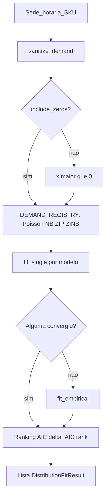
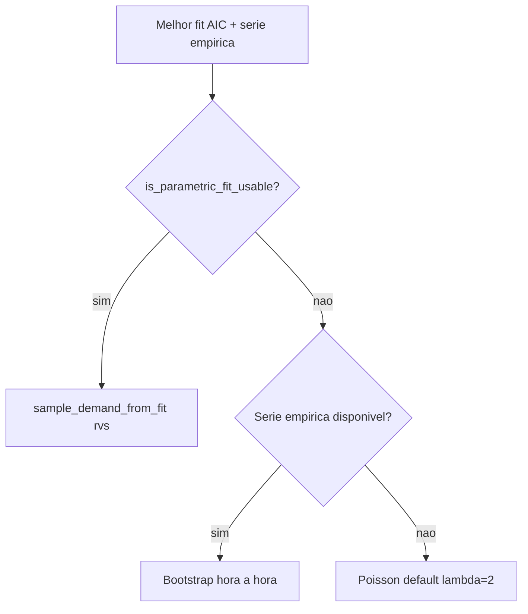

# Modelagem estatística e FDC — especificação para reutilização

**Hospital Demand Distribution Analyzer** — documento de referência para portar a modelagem de demanda medicamentosa para outro sistema (serviço, pipeline de dados, ERP, etc.).

Este arquivo consolida **métodos**, **distribuições (FDC)** e **regras de decisão** implementados no código. Detalhes de métricas e simulações especializadas estão nos documentos linkados ao final.

---

## 1. Escopo e premissas de domínio

| Premissa | Descrição |
|----------|-----------|
| Unidade temporal | **1 hora** (grade regular) |
| Variável | Demanda **medicamentosa** por SKU, quantidade inteira **≥ 0** |
| Intermitência | Horas sem consumo são **zeros explícitos** (zero-fill na grade horária) |
| Unidade de análise | SKU (`produto`) ou agregado de cluster |
| Objetivo | Estimar FDC da demanda horária, comparar modelos, simular consumo (Monte Carlo) |

**Regra operacional:** demanda negativa é descartada antes de qualquer ajuste ou simulação.

**Modo de representação:** a FDC de demanda usa **sempre modelos discretos de contagem**. Distribuições contínuas existem no código apenas como registro reservado para variáveis temporais futuras (`TEMPORAL_REGISTRY`).

---

## 2. Pipeline de dados (pré-ajuste)

### 2.1 Sanitização

Entrada: vetor `x` de demandas horárias (float ou int).

```
sanitize_demand(x) → { x_i | x_i ≥ 0 }
```

Implementação: `src/hospital_demand_analyzer/domain/demand_values.py`

### 2.2 Inclusão de zeros

| Flag | Efeito |
|------|--------|
| `include_zeros=True` (padrão) | Usa toda a grade horária, incluindo horas com demanda 0 |
| `include_zeros=False` | Restringe a `{ x_i | x_i > 0 }` (demanda condicional positiva) |

Usado em histogramas/FDC condicionais e alguns overlays gráficos (`positive_only`).

### 2.3 FDC empírica (ECDF)

Referência visual e baseline não paramétrica:

```
F_n(x) = (1/n) · |{ i : x_i ≤ x }|
```

Implementação: `src/hospital_demand_analyzer/statistics/ecdf.py` → `compute_ecdf()`

---

## 3. Catálogo de FDCs

### 3.1 Demanda medicamentosa (`DEMAND_REGISTRY`)

Estas quatro distribuições são ajustadas em `fit_all()` para cada SKU.

| Modelo | Nome no app | Tipo | Parâmetros | n_params | Método de estimação |
|--------|-------------|------|------------|----------|---------------------|
| Poisson | `Poisson` | discreta | λ | 1 | MLE analítico: λ̂ = x̄ |
| Binomial Negativa | `Negative Binomial` | discreta | n, p | 2 | Método dos momentos (scipy `nbinom(n,p)`) |
| Zero-Inflated Poisson | `Zero-Inflated Poisson` | discreta | π, λ | 2 | MLE (statsmodels; fallback scipy) |
| Zero-Inflated NB | `Zero-Inflated Negative Binomial` | discreta | π, n, p | 3 | MLE (statsmodels; fallback scipy) |

Registro: `src/hospital_demand_analyzer/statistics/distributions/registry.py`

### 3.2 Fallback empírico (FDC observada)

| Modelo | Nome no app | Tipo | Parâmetros | Quando entra |
|--------|-------------|------|------------|--------------|
| Empírica | `Empírica (FDC observada)` | não paramétrica | μ/h, n_horas, P95/h | **Somente** se nenhuma das 4 paramétricas convergir |

**Regra crítica:** a empírica **não compete** no ranking AIC no fluxo normal — evita “vencer” sempre com 0 parâmetros.

Verossimilhança (MLE da massa empírica):

```
log L = Σ_k n_k · log(n_k / n)
```

onde `n_k` é a frequência do valor inteiro `k` e `n` o tamanho da amostra.

### 3.3 Reservado para variáveis temporais (`TEMPORAL_REGISTRY`)

**Não usado** no ajuste de demanda medicamentosa hoje. Mantido para evolução futura (ex.: tempo até evento, duração de intervalo):

| Modelo | scipy_name |
|--------|------------|
| Exponential | `expon` |
| Gamma | `gamma` |
| Lognormal | `lognorm` |
| Weibull | `weibull_min` |

Estimação prevista: `scipy.stats.*.fit()` quando integrado.

---

## 4. Fórmulas PMF / CDF (portabilidade)

### 4.1 Poisson

```
P(X = k) = e^{-λ} · λ^k / k!        , k = 0, 1, 2, …
E[X] = λ ,  Var(X) = λ
```

### 4.2 Binomial Negativa (parametrização scipy)

Com parâmetros `(n, p)` onde `n > 0`, `p ∈ (0, 1)`:

```
E[X] = n(1-p)/p ,  Var(X) = n(1-p)/p²
```

Estimação por momentos (implementação atual):

```
p̂ = μ / σ² ,   n̂ = μ · p̂ / (1 - p̂)     (requer σ² > μ e μ > 0)
```

### 4.3 ZIP (Zero-Inflated Poisson)

π = probabilidade de **zero estrutural**; λ = taxa Poisson da parte de contagem.

```
P(X = 0) = π + (1 - π) · e^{-λ}
P(X = k) = (1 - π) · Poisson(k; λ)     , k ≥ 1
E[X] = (1 - π) · λ
```

Amostragem: com prob. π retorna 0; senão sorteia `Poisson(λ)`.

Implementação: `src/hospital_demand_analyzer/statistics/distributions/zero_inflated.py`

### 4.4 ZINB (Zero-Inflated Negative Binomial)

```
P(X = 0) = π + (1 - π) · NB(0; n, p)
P(X = k) = (1 - π) · NB(k; n, p)     , k ≥ 1
E[X] = (1 - π) · E[NB(n,p)]
```

MLE via `statsmodels.discrete.count_model.ZeroInflatedNegativeBinomialP`; conversão NB2 → `(n, p)` scipy quando necessário.

### 4.5 FDC teórica (CDF)

Para modelos discretos, a CDF em `x` é a soma acumulada da PMF até `⌊x⌋`. Usada em testes KS/CvM/AD e overlays gráficos.

---

## 5. Método de ajuste (`fit_all`)

### 5.1 Fluxo



Implementação: `src/hospital_demand_analyzer/statistics/fitter.py`

### 5.2 Guardas e falhas

| Condição | Comportamento |
|----------|---------------|
| `n < 5` observações | Ajuste paramétrico individual falha (`converged=False`) |
| Valores negativos | Excluídos com aviso |
| MLE não converge / log L = -∞ | Modelo descartado; outros continuam |
| Exceção no fit | Modelo marcado como falha; pipeline não interrompe |
| Nenhuma paramétrica válida | Acrescenta `Empírica (FDC observada)` se `n ≥ 5` |

### 5.3 Estimacao ZIP / ZINB (detalhe)

1. **Primário:** `statsmodels` — `ZeroInflatedPoisson` / `ZeroInflatedNegativeBinomialP` com `exog = ones(n, 1)`, `fit(disp=0)`.
2. **Fallback:** otimização `scipy.optimize.minimize` (L-BFGS-B) sobre log-verossimilhança negativa.

Parâmetros armazenados após fit:

| Modelo | Chaves em `params` |
|--------|-------------------|
| Poisson | `lambda` |
| Negative Binomial | `n`, `p` |
| ZIP | `pi`, `lambda` |
| ZINB | `pi`, `n`, `p` |
| Empírica | `media_h`, `n_horas`, `p95_h` |

---

## 6. Seleção e comparação de modelos

### 6.1 Critérios de informação

```
AIC  = 2k - 2 log L
AICC = AIC + 2k(k+1)/(n-k-1)     (se n-k-1 > 0)
BIC  = k log(n) - 2 log L
```

onde `k` = número de parâmetros livres, `n` = tamanho da amostra.

**Critério principal de ranking:** menor **AIC** → `rank = 1`.

Implementação: `src/hospital_demand_analyzer/statistics/metrics.py`

### 6.2 Goodness-of-fit (diagnóstico)

| Métrica | Uso |
|---------|-----|
| KS (D) | Máximo desvio entre CDF empírica e teórica |
| CvM | Integra quadrado do desvio em todo o domínio |
| AD | Pondera mais as caudas |
| Tail Fit Score | Erro relativo em P90, P95, P97.5, P99 (pesos 0.15–0.35) |

Detalhes completos: [`METRICAS_CDF.md`](METRICAS_CDF.md)

### 6.3 Funções de seleção

| Função | Papel |
|--------|-------|
| `best_fit(results)` | Retorna modelo convergente de **menor AIC** (usado em Monte Carlo, export CDF) |
| `top_n(results, n)` | Top-n por AIC |
| `select_fits_for_display(results, zero_ratio)` | Até 3 curvas no gráfico: top AIC + promoção se `% zero ≥ 10%` |

**Promoção com muitos zeros:** se `zero_ratio ≥ 0.10`, tenta incluir (nesta ordem) ZIP, ZINB, Poisson ou Negative Binomial entre as curvas exibidas, mesmo que não estejam no top-2 AIC puro.

---

## 7. Cadeia de amostragem (simulação)

Decisão central: `resolve_demand_sampling()` em `src/hospital_demand_analyzer/statistics/demand_sampler.py`



### 7.1 Quando o fit paramétrico é “utilizável”

`is_parametric_fit_usable(fit)` retorna **False** se:

- Fit nulo, não convergente, ou nome = `Empírica (FDC observada)`
- Parâmetros não finitos ou fora do domínio (ex.: NB com `n < 1`, `p ∉ (0,1)`)
- ZIP/ZINB: `π ∉ [0,1)`, λ ≤ 0, etc.
- Probes de amostragem (`rvs`) falham repetidamente

### 7.2 Modos de amostragem

| Modo | Método |
|------|--------|
| Paramétrico | `dist.rvs(*params)` da FDC ajustada |
| Empírico | Sorteio uniforme com reposição da série horária observada |
| Default | `Poisson(λ=2)` — `DEFAULT_MEAN_HOURLY_DEMAND` |

### 7.3 Zeros na simulação

| Caso de uso | `allow_zero` | Demanda sorteada |
|-------------|--------------|------------------|
| TempQMin (estoque) | `True` | Inteiro **≥ 0** por hora (`sample_demand` via `_draw_hourly_demand`) |
| Qmin reabastecimento | `True` | Inteiro **≥ 0** por hora |

---

## 8. Casos de uso downstream

### 8.1 Monte Carlo TempQMin

**Pergunta:** quanto tempo até o saldo cair de `saldo_inicial` até `Qmin`?

| Parâmetro | Valor |
|-----------|-------|
| Passo | 60 min (`MINUTES_PER_STEP`) |
| Horizonte máx. | 8760 h (1 ano) |
| Demanda/hora | Melhor fit AIC → amostragem marginal (`allow_zero=True`); série empírica propagada na UI |
| Saída | TempQMin em minutos (percentis empíricos das trajetórias) |

Documentação: [`SIMULACAO_MONTE_CARLO_TEMQMIN.md`](SIMULACAO_MONTE_CARLO_TEMQMIN.md)  
Código: `src/hospital_demand_analyzer/statistics/monte_carlo.py`

### 8.2 Qmin de reabastecimento

**Pergunta:** qual demanda acumulada no intervalo de reabastecimento (ex.: 120 min)?

| Parâmetro | Valor |
|-----------|-------|
| Intervalo | Definido pelo usuário (minutos) |
| Demanda | Inteiros ≥ 0 hora a hora (fração na última hora parcial) |
| Qmin proposta | **P95** da demanda acumulada simulada |
| Fallback | Mesma cadeia §7 se fit inválido |

Documentação: [`QMIN_REABASTECIMENTO_MONTE_CARLO.md`](QMIN_REABASTECIMENTO_MONTE_CARLO.md)  
Código: `src/hospital_demand_analyzer/statistics/replenishment_qmin.py`

---

## 9. Mapa de módulos (portabilidade)

| Responsabilidade | Caminho no repositório |
|------------------|------------------------|
| Registro Poisson/NB/ZIP/ZINB | `statistics/distributions/registry.py` |
| PMF/CDF/rvs ZIP e ZINB | `statistics/distributions/zero_inflated.py` |
| Engine `fit_all`, `fit_empirical` | `statistics/fitter.py` |
| AIC, BIC, KS, Tail Score | `statistics/metrics.py` |
| ECDF | `statistics/ecdf.py` |
| Resolução e amostragem | `statistics/demand_sampler.py` |
| Formato parâmetros / best_fit | `statistics/fit_params.py` |
| Modelo de resultado | `domain/models.py` → `DistributionFitResult` |
| Monte Carlo estoque | `statistics/monte_carlo.py` |
| Monte Carlo Qmin | `statistics/replenishment_qmin.py` |
| Sanitização demanda | `domain/demand_values.py` |

### 9.1 Estrutura `DistributionFitResult` (campos essenciais)

```
name, dist_type, params, log_likelihood, n_params,
aic, aicc, bic, delta_aic, delta_bic,
ks_stat, cvm_stat, ad_stat, tail_fit_score,
converged, warnings, rank, rank_tail
```

---

## 10. Dependências e defaults operacionais

### 10.1 Stack mínimo (Python)

| Pacote | Versão | Uso |
|--------|--------|-----|
| Python | ≥ 3.11 | Runtime |
| numpy | ≥ 1.26 | Arrays, percentis |
| scipy | ≥ 1.11 | Poisson, NB, otimização, GoF |
| statsmodels | ≥ 0.14 | MLE ZIP/ZINB |

### 10.2 Defaults relevantes para modelagem

| Constante | Valor | Onde |
|-----------|-------|------|
| `DEFAULT_MEAN_HOURLY_DEMAND` | **2.0** un/h | Fallback de amostragem |
| IQR multiplier (outliers) | **5.0** | Tukey em horas com demanda > 0 |
| Corte Alto Giro (cluster) | **2.0** | Import / clustering |
| Amostra mínima para fit | **5** | `fit_single`, `fit_empirical` |
| Promoção zero-inflated | **10%** zeros | `select_fits_for_display` |

Config: `config/default.json`, `src/hospital_demand_analyzer/utils/config.py`

### 10.3 Checklist para reimplementar em outro sistema

1. Grade horária regular com **zero-fill** por SKU.
2. Pipeline `sanitize` → `fit_all` (4 discretas) → ranking AIC → `best_fit`.
3. Fallback empírico **somente** se todas paramétricas falharem.
4. Simulação: validar fit → paramétrico / bootstrap / Poisson(2).
5. Persistir `DistributionFitResult` (nome, params, AIC, converged) por SKU.
6. ZIP/ZINB: usar statsmodels ou reimplementar MLE com PMF da §4.
7. Métricas de cauda (Tail Fit Score) se decisões logísticas dependem de P95–P99.

---

## 11. Referências cruzadas

| Documento | Conteúdo |
|-----------|----------|
| [`METRICAS_CDF.md`](METRICAS_CDF.md) | Definições completas AIC, KS, CvM, AD, Tail Fit Score |
| [`SIMULACAO_MONTE_CARLO_TEMQMIN.md`](SIMULACAO_MONTE_CARLO_TEMQMIN.md) | Algoritmo saldo hora a hora e TempQMin |
| [`QMIN_REABASTECIMENTO_MONTE_CARLO.md`](QMIN_REABASTECIMENTO_MONTE_CARLO.md) | Qmin por tempo de reabastecimento |
| [`TAIL_FIT_SCORE.md`](TAIL_FIT_SCORE.md) | Detalhe da métrica de cauda |
| [`ARCHITECTURE.md`](ARCHITECTURE.md) | Camadas do app e fluxo de dados |

---

## 12. Aviso metodológico

> **Melhor distribuição** significa melhor modelo **entre as candidatas avaliadas** (Poisson, NB, ZIP, ZINB ou empírica de fallback), não a “verdadeira” distribuição geradora da demanda hospitalar.

Para SKUs com histórico curto ou padrão atípico, prefira inspecionar FDC empírica, `% zero` e métricas de cauda antes de automatizar decisões de estoque.
