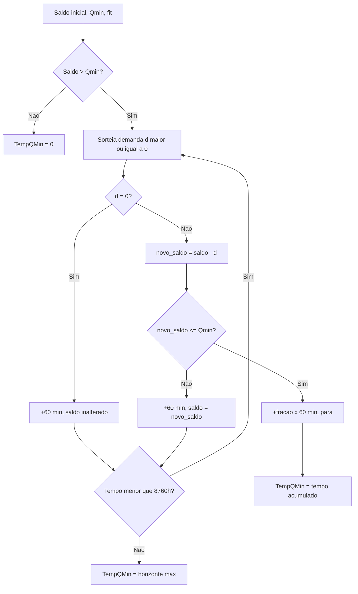

# Simulação Monte Carlo — TempQMin e saldo hora a hora

**Hospital Demand Distribution Analyzer** — documentação do algoritmo da etapa 8 (Simulação Monte Carlo): evolução do estoque hora a hora e estimação do tempo até atingir o estoque mínimo (Qmin).

---

## 1. Visão geral

A simulação responde à pergunta: **quanto tempo leva** para o saldo cair de um **saldo inicial** até atingir o **Qmin** (estoque mínimo), dado um padrão de demanda sorteado a partir da melhor distribuição ajustada (menor AIC).

| Aspecto | Valor |
|---------|-------|
| Passo temporal | **1 hora = 60 minutos** (`MINUTES_PER_STEP`) |
| Demanda por hora | Sorteada da FDC ajustada (marginal); **inteiro ≥ 0** |
| Horizonte máximo | **8760 h** (1 ano) — `DEFAULT_MAX_HORIZON_HOURS` |
| Saída principal | **TempQMin** em **minutos** (UI também exibe horas) |

**Implementação central:** `src/hospital_demand_analyzer/statistics/monte_carlo.py`

**Interface:** etapa 8 — `ui/views/monte_carlo_view.py`

---

## 2. Parâmetros iniciais

Antes da simulação hora a hora, três grandezas definem cada trajetória:

| Parâmetro | Como é definido |
|-----------|-----------------|
| **Saldo inicial** | Informado na UI, ou padrão: `Qmin × fator`, com fator aleatório ∈ [5, 10] |
| **Qmin** | Informado na UI, ou padrão: `média horária × 24 h` (inteiro ≥ 1) |
| **Demanda horária** | Sorteada por `sample_hourly_demand()` a partir do melhor ajuste do SKU |

Saldo e Qmin são normalizados para **inteiros ≥ 1** antes de simular (`normalize_inventory_level()`).

### Caso especial

Se `saldo_inicial ≤ Qmin`, a trajetória termina imediatamente com **TempQMin = 0** — não há consumo a simular.

**Sorteio de demanda:** `src/hospital_demand_analyzer/statistics/demand_sampler.py`

---

## 3. Cálculo do saldo hora a hora

A lógica está em `simulate_single_trajectory()`. A cada iteração do loop principal:

1. Sorteia a demanda `d` (≥ 0) da distribuição ajustada.
2. Se `d = 0`, o saldo permanece inalterado e o tempo avança **60 minutos inteiros**.
3. Se `d > 0`, calcula `novo_saldo = saldo_anterior − d` e avalia se o Qmin foi cruzado nesta hora.

### Caso A — saldo permanece acima do Qmin

Condição: `novo_saldo > Qmin`

- O saldo passa a ser `novo_saldo`.
- O tempo avança **60 minutos inteiros**.
- Registra-se o ponto `(tempo, saldo)` na trajetória.
- A simulação continua.

### Caso B — Qmin é cruzado nesta hora

Condição: `novo_saldo ≤ Qmin`

A hora **não** é contada por completo. Assume-se consumo **uniforme** dentro da hora (interpolação linear). A fração da hora até atingir exatamente Qmin é:

```
fração = (saldo_anterior − Qmin) / demanda
```

O tempo avança `fração × 60` minutos e a simulação **para**.

### Pseudocódigo (trecho equivalente ao código)

```
saldo ← saldo_inicial
tempo_min ← 0

enquanto saldo > Qmin e tempo_min < horizonte_max:
    d ← sortear_demanda()
    se d = 0:
        tempo_min ← tempo_min + 60
        registrar (tempo_min, saldo)
        continuar

    saldo_anterior ← saldo
    novo_saldo ← saldo_anterior − d

    se novo_saldo ≤ Qmin:
        fração ← (saldo_anterior − Qmin) / d
        tempo_min ← tempo_min + fração × 60
        registrar (tempo_min, novo_saldo)
        parar

    saldo ← novo_saldo
    tempo_min ← tempo_min + 60
    registrar (tempo_min, saldo)
```

**Referência no código:** linhas 68–84 de `statistics/monte_carlo.py`.

---

## 4. Exemplo numérico

Parâmetros: saldo inicial = **520**, Qmin = **500**, demandas sorteadas = **10** e **50**.

| Passo | Demanda | Saldo após | Tempo acumulado |
|-------|---------|------------|-----------------|
| Início | — | 520 | 0 min |
| Hora 1 | 10 | 510 (> 500) | +60 min → **60 min** |
| Hora 2 | 50 | cairia para 460 (≤ 500) | fração = (510−500)/50 = **0,2** → +12 min |

**TempQMin = 60 + 12 = 72 min (1,2 h)**

Este exemplo é validado pelo teste `test_fractional_tempqmin_on_crossing_in_minutes` em `tests/test_monte_carlo.py`.

---

## 5. Estimação do TempQMin

### Por trajetória

**TempQMin** = tempo em **minutos** desde t = 0 até o saldo atingir Qmin em **uma** simulação.

| Situação | TempQMin |
|----------|----------|
| Cruza Qmin (com ou sem fração na última hora) | Tempo acumulado no instante do cruzamento |
| Nunca cruza em 8760 h | Horizonte máximo (8760 × 60 min) |
| Saldo inicial ≤ Qmin | **0** |

### Monte Carlo (N trajetórias)

`run_tempqmin_monte_carlo()` repete a simulação **N vezes** (padrão: 100). Cada repetição sorteia demandas independentes. O vetor `[TempQMin₁, …, TempQMinₙ]` alimenta `compute_tempqmin_stats()`.

| Estatística | Cálculo |
|-------------|---------|
| Média | `mean(temp_times)` |
| Mediana (P50) | `median(temp_times)` |
| P5, P10, P90, P95 | Percentis sobre as N trajetórias |
| Desvio padrão, mínimo, máximo | Estatísticas descritivas do vetor |

Não há fórmula analítica fechada para TempQMin: a estimativa é **empírica**, obtida por Monte Carlo. A precisão melhora com N maior (custo computacional proporcional).

---

## 6. Diagrama de fluxo



---

## 7. Pontos importantes na prática

- **Unidades:** TempQMin é armazenado e calculado em **minutos**; a UI formata também em horas (`format_tempqmin()` → ex.: `72.0 min (1.2 h)`).
- **Amostragem marginal:** cada hora sorteia demanda **≥ 0** conforme a FDC ajustada (Poisson, NB, ZIP, ZINB). Horas com `d = 0` não consomem estoque — coerente com a série histórica zero-fill.
- **Saldo final abaixo de Qmin:** no cruzamento, o último ponto da trajetória pode registrar saldo < Qmin (ex.: 460 com Qmin = 500). O que importa para TempQMin é o **instante** do cruzamento, não o saldo final.
- **Normalização:** saldo e Qmin informados na UI são arredondados para inteiros ≥ 1 antes da simulação.
- **Gráfico vs estatísticas:** o gráfico de trajetórias mostra **saldo × tempo (min)** ao longo do caminho; o painel TempQMin resume apenas o tempo até Qmin em cada uma das N simulações.

---

## 8. Referências de implementação

| Módulo | Papel |
|--------|-------|
| `src/hospital_demand_analyzer/statistics/monte_carlo.py` | Core: trajetória única, agregação Monte Carlo, estatísticas |
| `src/hospital_demand_analyzer/statistics/demand_sampler.py` | Sorteio de demanda horária a partir do fit |
| `src/hospital_demand_analyzer/ui/views/monte_carlo_view.py` | Interface etapa 8 |
| `src/hospital_demand_analyzer/plots/monte_carlo_plot.py` | Gráfico de trajetórias saldo × tempo |
| `src/hospital_demand_analyzer/domain/models.py` | `MonteCarloTrajectory`, `TempQMinResult` |
| `tests/test_monte_carlo.py` | Testes unitários (cruzamento fracionário, N trajetórias) |

---

## 9. Relação com o restante do pipeline

1. **Etapas 1–5:** série horária normalizada e estatísticas descritivas (média horária alimenta Qmin padrão).
2. **Etapa 7 (Distribuições):** ajuste probabilístico por SKU → parâmetros usados no sorteio de demanda.
3. **Etapa 8 (Monte Carlo):** simulação TempQMin com o melhor ajuste (AIC) em cache ou calculado em background.

Para métricas de ajuste de distribuição, ver [`METRICAS_CDF.md`](METRICAS_CDF.md).
